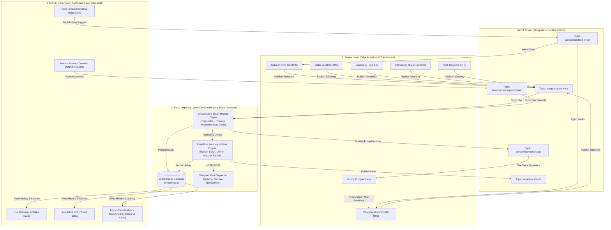

# Fog-Based IoT System for Automated Monitoring, Misting Control, and Fault Detection in Vertical Aeroponic Farming

A complete, production-ready, edge/fog-computing IoT project designed for high-density vertical aeroponics. The system provides sub-millisecond automated misting control, multi-parameter environmental sensing, edge anomaly detection, offline local resilience, and a real-time Streamlit dashboard.

---

## 🏗️ System Architecture



---

## 📖 Theoretical Explanations for Academic Viva & Project Defense

### Layer 1: Sensor Layer
Simulates real-world transducers installed inside the aeroponic root chamber and the nutrient reservoir (Ambient Air Temperature, Chamber Humidity, Water Tank Reservoir Level, Solution pH, Electrical Conductivity / EC, and Root-zone Temperature). It features a physical feedback loop where misting nozzle actuation actively raises chamber humidity, while pump dormancy allows evaporation to lower humidity.

### Layer 2: Fog Computing Layer
An on-site intelligent micro-controller or gateway (such as a Raspberry Pi or industrial edge gateway) deployed directly inside the greenhouse. It runs closed-loop control algorithms, calculates duty cycles adapted to temperature, performs anomaly detection with alert cooldowns, and maintains a local SQLite database without needing constant cloud or internet connectivity.

### Layer 3: Cloud & Dashboard Layer
A centralized visualization, supervisory control, and data analytics portal built with Streamlit. It presents real-time cards, auto-updating Plotly charts, manual actuator overrides, fault simulation testing benches, and live architectural benchmarking comparing local fog latency to remote cloud routing.

### Why MQTT is Used
MQTT (Message Queuing Telemetry Transport) is a lightweight, asynchronous, publish-subscribe messaging protocol designed specifically for constrained IoT devices and low-bandwidth, unreliable networks. Unlike request-response HTTP (which incurs high TCP handshake overhead and polling latency), MQTT operates with tiny 2-byte header packets, quality-of-service (QoS) guarantees, and instantaneous event-driven broker dissemination.

### Why This is "Fog" Computing and Not Just "Cloud"
In pure **Cloud Computing**, sensor telemetry travels hundreds of miles across the public internet to remote cloud servers (AWS/Azure/GCP) before control decisions are transmitted back. In high-pressure aeroponics, plant roots are suspended naked in air; if the internet link goes down or suffers jitter, root hairs desiccate and die within minutes. 
**Fog Computing** decentralizes processing by placing computation and actuation logic on the local network edge, avoiding a WAN round trip for time-sensitive decisions. Even during a total WAN/internet failure, the local Fog Node continues misting and fault mitigation autonomously. The Python dashboard's latency value times the decision routine and its optional injected delay; it does not include the full sensor-to-pump network path.

### iFogSim2 Digital Twin (Java)
The project bundles the official iFogSim2 source and libraries, plus an aeroponics model of the humidity-sensor → misting-controller → pump loop. The dashboard includes an **iFogSim Digital Twin** page for running fog-gateway and cloud placements, varying sensor-zone count and WAN delay, and viewing/exporting simulated end-to-end loop results. The Python MQTT stack remains the live IoT demonstration. The sidebar's configurable cloud delay is a separate illustration, not an iFogSim measurement. See [`ifogsim/README.md`](ifogsim/README.md) for setup and academic explanation.

---

## 🚀 Setup & Installation Instructions

### 1. Prerequisites
- Python 3.10, 3.11, 3.12, 3.13, or 3.14.
- Mosquitto MQTT Broker (or use the built-in python broker `broker.py`).

#### Installing Mosquitto (Recommended):
- **Windows**: Download and install from [mosquitto.org/download](https://mosquitto.org/download/). Start it via Windows Services or run `mosquitto -v` in a terminal.
- **Linux (Ubuntu/Debian)**:
  ```bash
  sudo apt update
  sudo apt install -y mosquitto mosquitto-clients
  sudo systemctl start mosquitto
  sudo systemctl enable mosquitto
  ```
- **macOS**:
  ```bash
  brew install mosquitto
  brew services start mosquitto
  ```

### 2. Install Python Dependencies
Open a terminal in the project directory (`aeroponics_fog`):
```bash
cd aeroponics_fog
pip install -r requirements.txt
```

---

## 🎮 How to Run the Project

### Option A: The One-Click Launcher (Recommended)
You can start all components together with a single command:
```bash
python run_all.py
```
*Note: If Mosquitto is not installed, `run_all.py` automatically launches `broker.py` as an embedded MQTT broker!*

---

### Option B: Running Each Stage Individually in Separate Terminals

#### Terminal 1: MQTT Broker
If Mosquitto is already running as a system service, skip this step. Otherwise:
```bash
python broker.py
# Or: mosquitto -v
```

#### Terminal 2: Sensor Simulator (Stage 1)
```bash
python sensor_simulator.py
```
*What you see:* Realistic sensor packets generated every 2 seconds with ambient temperature, humidity, root-zone temperature, pH, EC, and reservoir level.

#### Terminal 3: Fog Node (Stages 2, 3, 4)
```bash
python fog_node.py
```
*What you see:* Live incoming sensor telemetry, automatic misting decisions (`Pump ON` when humidity < 70%, `Pump OFF` when humidity > 85% or mist duration expires), fault checks, and SQLite commits.

#### Terminal 4: Streamlit Dashboard (Stages 5, 6)
```bash
streamlit run dashboard.py
```
*What you see:* Opens `http://localhost:8501` in your browser with real-time gauges, trend charts, control buttons, and fault alert panels.

---

## 🧪 Comprehensive Demo Script (Step-by-Step for Presentation)

Follow this exact sequence of clicks during your project demonstration or viva:

1. **Verify Baseline Closed-Loop Monitoring (AUTO Mode):**
   - Open the dashboard at `http://localhost:8501`.
   - Observe the 6 live metric cards updating every 2 seconds.
   - Observe the Chamber Humidity chart: when humidity dips below **70%**, notice the Fog Node turns the pump **ON** (badge turns blue `💧 ON`).
   - As the pump runs, observe humidity climbing until it reaches **85%** or the 5-second cycle finishes, causing the pump to shut **OFF**.

2. **Test Manual Actuation Override:**
   - In the sidebar under **Actuator Override**, click **⚡ Pump ON**.
   - Notice the status immediately switches to `MANUAL`, the pump starts running, and decision latency indicates `< 5ms`.
   - Click **🛑 Pump OFF**; verify the pump cuts off immediately.
   - Click **🟢 AUTO**; verify system resumes closed-loop autonomous misting.

3. **Demonstrate Fault 1: Stuck Sensor:**
   - In the sidebar under **Fault Injection**, click **❄️ Stuck Sensor**.
   - Watch the simulator freeze humidity at an identical float value.
   - Within 10 seconds (5 consecutive identical readings), observe the **Fault Detection & Alert Panel** flag a `[🟡 WARNING] STUCK_SENSOR` alert.

4. **Demonstrate Fault 2: Out-of-Range Sensor:**
   - Click **💥 Out of Range**.
   - The temperature will spike to `-50.0 °C`.
   - The dashboard alerts a `[🔴 CRITICAL] OUT_OF_RANGE` error indicating physical transducer failure or line short.

5. **Demonstrate Fault 3: Sensor Node Offline:**
   - Click **📴 Sensor Offline**.
   - The simulator pauses telemetry for 15 seconds.
   - The Fog Node's watchdog thread detects the loss of communication and triggers a `[🔴 CRITICAL] SENSOR_OFFLINE` alarm after 10 seconds.

6. **Demonstrate Fault 4: Pump / Actuator Failure:**
   - Click **⚠️ Pump Failure**.
   - The misting pump is commanded ON, but simulated nozzles remain dry.
   - After 20 seconds of continuous pump operation without humidity rising, a `[🔴 CRITICAL] PUMP_FAILURE` alert is declared.
   - Click **🧹 Clear / Reset Faults** to restore normal operation.

7. **Demonstrate Stage 6: Fog vs Cloud Architectural Benchmark:**
   - Look at the **Fog vs Cloud Architectural Evaluation** section. Notice Fog latency is **< 2 ms**.
   - Toggle **"Simulate Cloud Processing (+300ms latency)"** ON.
   - Trigger a pump override: notice latency jumps to **~305 ms**, visually reflected on the comparison bar chart.
   - Toggle **"Internet Connected"** to **OFF** (simulating WAN severance).
   - Show the examiners that despite the internet being completely severed, the **Fog Node continues local misting and safety operations autonomously**, proving the resilience of Fog Computing over Cloud Computing!

---

## 🛠️ Configuration Guide (`config.json`)

All operational parameters are centralized in `config.json` for easy tuning:
- `sensor_thresholds`: Defines safe operating boundaries for temp, humidity, water level, pH, EC, and root temp.
- `misting_control`: Set `humidity_low_threshold` (70%), `humidity_high_threshold` (85%), `mist_duration_sec` (5s), and adaptive `hot_rest_sec` (8s).
- `fault_detection`: Configure `stuck_reading_threshold` (5 cycles), `sensor_offline_timeout_sec` (10s), `pump_failure_timeout_sec` (20s), and `fault_cooldown_sec` (10s).
- `telegram`: Add your Telegram bot token and chat ID for instant mobile alerts. If left blank `""`, it gracefully skips.

---

## ❓ Troubleshooting

| Issue | Cause | Solution |
| :--- | :--- | :--- |
| `ConnectionRefusedError: [WinError 10061]` | MQTT broker is not running on port 1883 | Run `python broker.py` or start the Mosquitto service (`net start mosquitto`). |
| Streamlit dashboard says `Waiting for sensor readings...` | `sensor_simulator.py` or `fog_node.py` is not running | Ensure `sensor_simulator.py` and `fog_node.py` are started, or launch via `python run_all.py`. |
| `ModuleNotFoundError: No module named 'paho'` | Virtualenv or packages missing | Run `pip install -r requirements.txt`. |
| Port 8501 is already occupied | Another Streamlit session is active | Run `streamlit run dashboard.py --server.port 8502`. |
